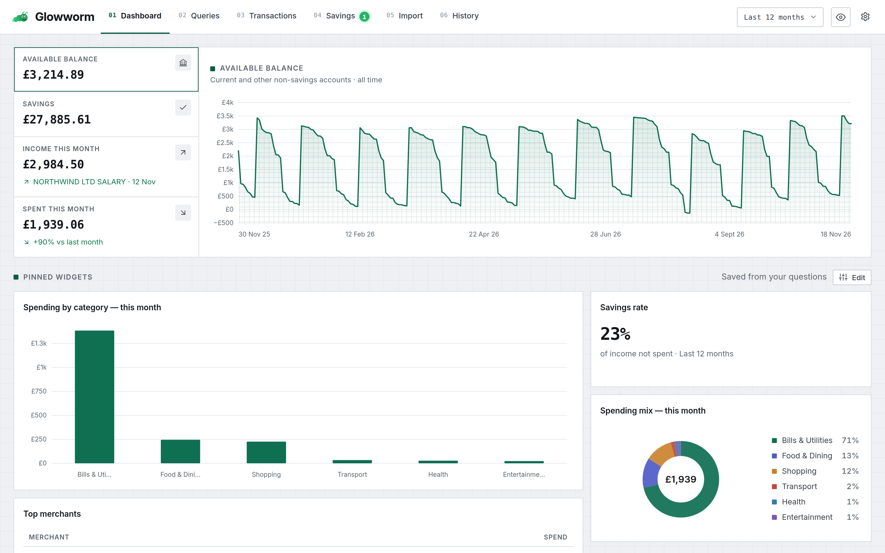
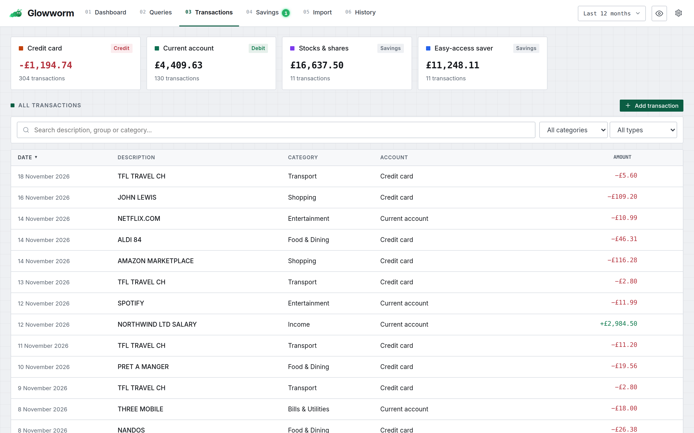
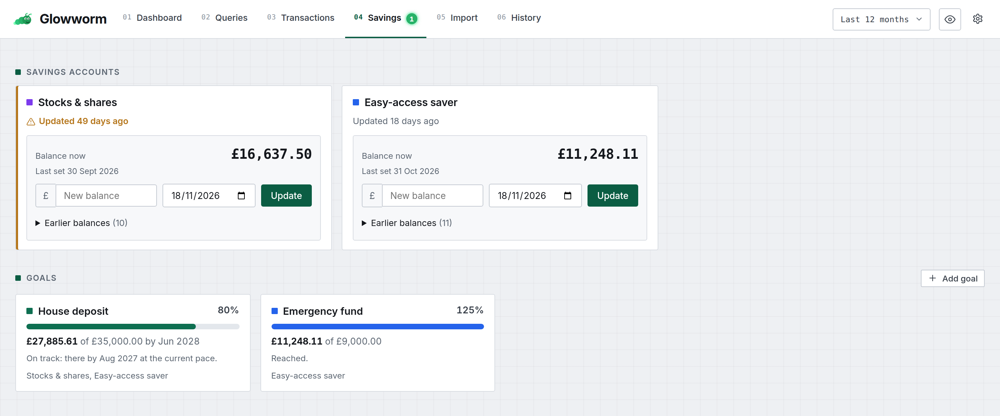
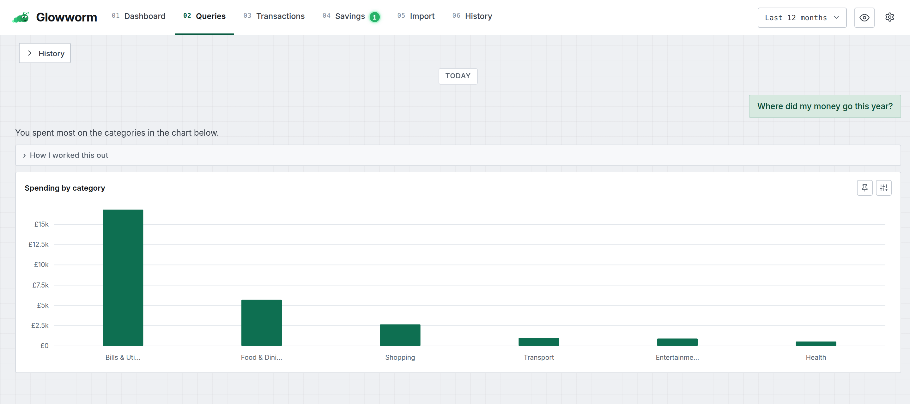
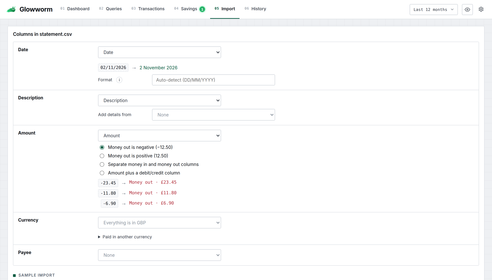
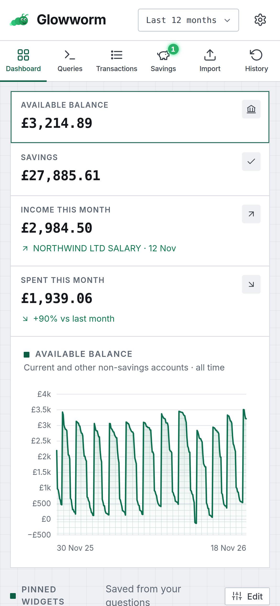
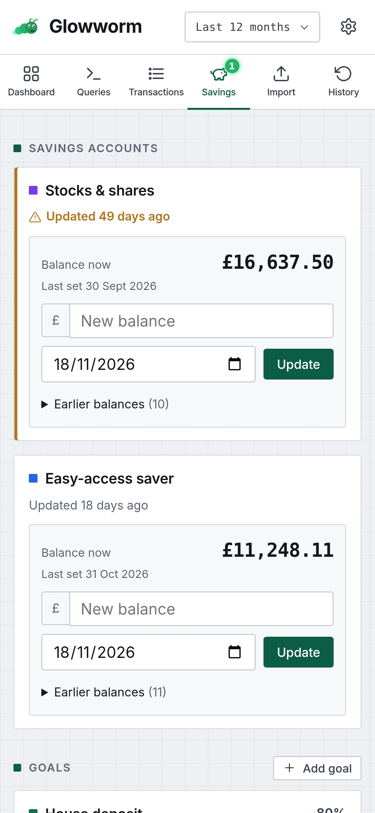
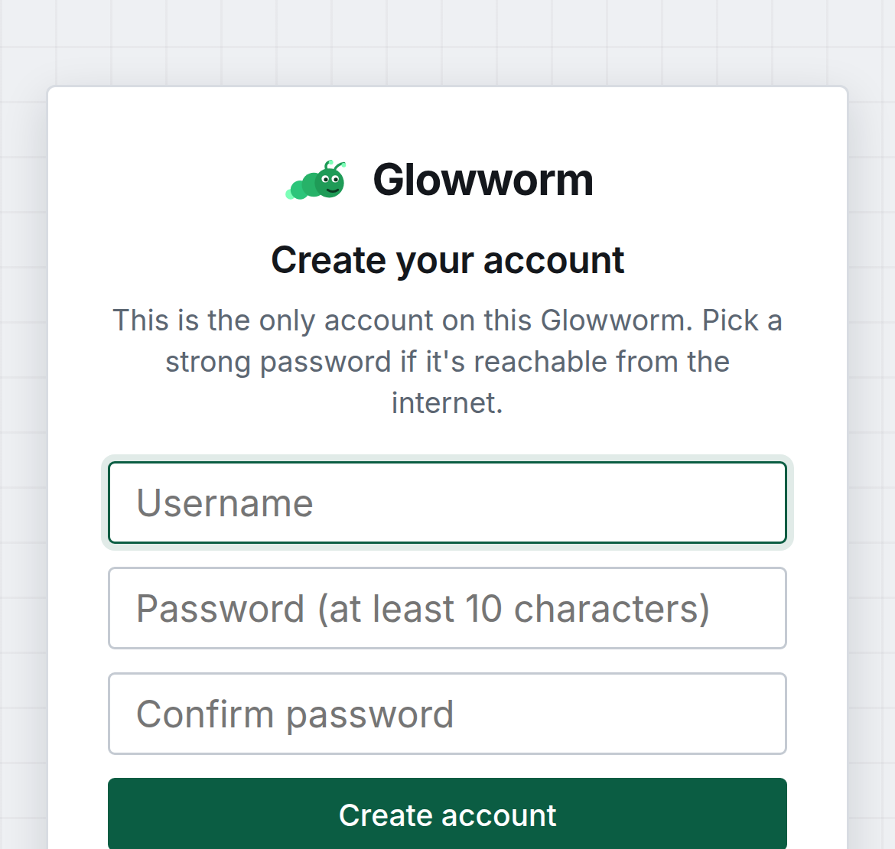

<p align="center">
  
</p>

<h1 align="center">Glowworm</h1>

<p align="center">
  <strong>Finance, made clear.</strong><br>
  A personal finance tracker you run yourself. Drop in your bank statements and
  see where your money goes, how your savings are doing, and ask questions about
  it in plain English.
</p>

<p align="center">
  <a href="#install">Install</a> ·
  <a href="#getting-started">Getting started</a> ·
  <a href="#screenshots">Screenshots</a> ·
  <a href="#questions-and-problems">Help</a>
</p>

<picture>
  <source media="(prefers-color-scheme: dark)" srcset="docs/screenshots/dashboard-dark.png">
  
</picture>

## What it does

- **Imports your bank statements.** CSV, Excel, OFX or QIF, from any bank.
  Glowworm works out the columns (with AI if you set it up, or you pick them
  once) and remembers the format for next time.
- **Sorts your spending.** Transactions are put into categories by rules you
  can teach. It spots transfers between your own accounts and regular bills.
- **Tracks your savings.** Keep the balance of each savings or investment
  account up to date, set goals like a house deposit, and see whether you're
  on track. It can remind you on your phone when a balance needs updating.
- **Answers questions.** Ask "where did my money go this year?" and get an
  answer with a chart. Pin the charts you like to the dashboard.
- **Stays yours.** It runs on your own computer or server, with your data in
  one folder. Nothing is sent anywhere unless you turn it on (see
  [Privacy](#privacy)).
- **Works on your phone.** Install it to your home screen, sign in with a
  passkey, and use it like an app. Light and dark themes.

## Screenshots

| | |
|---|---|
|  |  |
| **Transactions** from every account, searchable and filterable | **Savings** balances and goals, with a warning when one is out of date |
|  |  |
| **Queries** in plain English, answered with charts | **Import** any bank's statement; match its columns once |

<p align="center">
  
  &nbsp;&nbsp;
  
</p>

<sub>The screenshots show made-up data.</sub>

## Install

Glowworm is a single program. You need a computer that's switched on whenever
you want to use it: a home server, a Raspberry Pi, a cloud server, or just your
own laptop to try it out.

**Which way should I pick?**

| If you have… | Use | Time |
|---|---|---|
| A Linux server or Raspberry Pi | [The install script](#on-a-linux-server) | 2 minutes |
| Docker or Podman already set up | [The container](#with-docker) | 2 minutes |
| A Mac or Windows PC, to try it out | [The app download](#on-a-mac-or-windows-pc) | 1 minute |
| Go installed, or want to change the code | [Build it yourself](#build-it-yourself) | 2 minutes |

**To use it from your phone or away from home**, the server needs a domain name
(like `money.example.com`) pointing at it, so it can have HTTPS. Passkeys,
reminders and installing Glowworm as an app need HTTPS. The install script and
the Docker setup can set this up for you with [Caddy](https://caddyserver.com),
which gets the certificate by itself. Without a domain, Glowworm still works on
the computer it runs on, or on your home network.

### On a Linux server

For any Linux machine with systemd: Ubuntu, Debian, Raspberry Pi OS, Fedora
and most others, on Intel/AMD or ARM.

1. Run:

   ```bash
   curl -fsSL https://github.com/ejagombar/Glowworm/releases/latest/download/install.sh | sh
   ```

   (You can [read the script](deploy/install.sh) first. It asks for your
   password through `sudo`.)

2. Answer the questions:
   - **Address.** Your domain, like `https://money.example.com`, or leave it
     empty to use Glowworm on this machine or your home network.
   - **Caddy.** Say yes to get HTTPS for that domain. The domain must already
     point at this machine, with ports 80 and 443 open.
   - **Automatic updates.** Say yes to install new releases each night, after a
     backup.

3. At the end it shows a link and a QR code. Open it, or scan it with your
   phone, to [create your account](#create-your-account).

Glowworm now runs in the background and starts with the machine. Its data is in
`/var/lib/glowworm` and its settings in `/etc/glowworm/glowworm.env`. Run the
script again any time to change your answers; your data stays.

### With Docker

1. Make a folder and download the two setup files:

   ```bash
   mkdir glowworm && cd glowworm
   curl -fsSLO https://raw.githubusercontent.com/ejagombar/Glowworm/main/deploy/compose.yaml
   curl -fsSLO https://raw.githubusercontent.com/ejagombar/Glowworm/main/deploy/Caddyfile
   ```

2. Start it:

   ```bash
   docker compose up -d
   docker compose logs glowworm
   ```

   The log shows the link that [creates your account](#create-your-account).
   Glowworm is at http://localhost:8080.

3. **For HTTPS at your domain**, create a file called `.env` in the same folder
   with your address:

   ```bash
   echo "GLOWWORM_PUBLIC_URL=https://money.example.com" > .env
   docker compose --profile caddy up -d
   ```

Your data is kept in a Docker volume called `glowworm-data`. The image is
`ghcr.io/ejagombar/glowworm`, for Intel/AMD and ARM.

<details>
<summary><strong>With Podman</strong></summary>

[`deploy/glowworm.container`](deploy/glowworm.container) runs Glowworm as a
systemd service through Podman, and Podman keeps it updated:

```bash
mkdir -p ~/.config/containers/systemd
curl -fsSL -o ~/.config/containers/systemd/glowworm.container \
  https://raw.githubusercontent.com/ejagombar/Glowworm/main/deploy/glowworm.container
systemctl --user daemon-reload
systemctl --user start glowworm
journalctl --user -u glowworm          # the setup link
systemctl --user enable --now podman-auto-update.timer
loginctl enable-linger "$USER"         # keep it running after you log out
```

Or by hand: `podman run -d --name glowworm -p 127.0.0.1:8080:8080 -v glowworm-data:/data ghcr.io/ejagombar/glowworm`.
For a host folder instead of a volume, add `:Z` on SELinux systems
(`-v ./data:/data:Z`).

</details>

### On a Mac or Windows PC

1. Download the file for your computer from the
   [latest release](https://github.com/ejagombar/Glowworm/releases/latest):

   | Computer | File |
   |---|---|
   | Mac with Apple silicon (M1 and later) | `glowworm-darwin-arm64` |
   | Mac with an Intel processor | `glowworm-darwin-amd64` |
   | Windows | `glowworm-windows-amd64.exe` |
   | Linux | `glowworm-linux-amd64` or `glowworm-linux-arm64` |

2. Put it in a folder of its own, for example `Glowworm` in your documents.
   Glowworm keeps its data in a `data` folder next to it.

3. Start it:
   - **Mac:** open Terminal in that folder and run:

     ```bash
     chmod +x glowworm-darwin-arm64
     xattr -d com.apple.quarantine glowworm-darwin-arm64   # allow a downloaded program
     ./glowworm-darwin-arm64
     ```

   - **Windows:** double-click `glowworm-windows-amd64.exe`. If Windows warns
     that it doesn't recognise the program, choose **More info → Run anyway**.

4. A window shows the link that [creates your account](#create-your-account).
   Keep the window open while you use Glowworm; closing it stops it.

The app only listens on your own computer (http://localhost:8080). To check a
download, compare it with `checksums.txt` on the release page.

### Build it yourself

With [Go](https://go.dev/dl/) 1.26 or later:

```bash
go install github.com/ejagombar/Glowworm/cmd/glowworm@latest
glowworm serve
```

Or from a clone: `make build && ./glowworm serve`.

## Create your account

The first time Glowworm starts, it prints a link with a code in it, and a QR
code when it can tell that your phone could open it:

```
  Glowworm is ready to set up. Open this address to create the account:

    https://money.example.com/setup?token=4GHBEWOKPFPAQI6ZC3PHLX64UC
```



Open it and choose a username and password. That's the only account; it owns
all the data. The code in the link stops anyone else who finds your Glowworm
from creating the account before you.

Lost the link? Run `glowworm setup-url` on the server (or look in the log)
to see it again.

<br clear="right">

## Getting started

Once you're signed in:

1. **Add your accounts** in Settings: current accounts, credit cards and
   savings. Give each one its balance on a date to start from.
2. **Import a statement.** Download a CSV (or Excel, OFX, QIF) from your bank's
   website and drop it on the Import page. Match up the columns the first time;
   Glowworm remembers them for that bank.
3. **Check the categories** on the Transactions page. Change any that are wrong,
   and Glowworm offers to do the same for similar transactions.
4. **Add your savings.** On the Savings page, type in each account's balance
   whenever you check it, and add goals. The Savings tab shows a number when a
   balance is out of date.
5. **Optionally, add an AI provider** in Settings: OpenAI, Anthropic, Google
   Gemini, a local model with Ollama, or anything OpenAI-compatible. It reads
   new statement formats, sorts transactions and answers questions. Without it,
   everything else works the same; you match columns and set rules yourself.

**On your phone** (needs HTTPS): open your Glowworm in Safari or Chrome and
choose *Add to Home Screen*. Then, in Settings, add a passkey to sign in with
Face ID or your fingerprint, and turn on reminders to get a notification when
a savings balance needs updating.

The eye button at the top hides every amount, for when someone's looking over
your shoulder.

## Updating

Glowworm checks once a day whether a new version is out, and says so in
Settings → Glowworm, with what to do:

- **Install script or app download:** `sudo glowworm update --restart glowworm`
  on a server (or `glowworm update`, then start it again). It backs up your
  data first.
- **Docker:** `docker compose pull && docker compose up -d`.
- **Podman:** happens by itself with `podman-auto-update.timer`.

A new version may upgrade the database. To go back to an older version, restore
the backup taken before the update (they're kept in `backups` inside the data
folder).

## Backups

- **Download one** from Settings → Backup & deletion. It's a `.zip` with all
  your data and the key that unlocks your stored AI key, so keep it private.
- **On the server:** `glowworm backup` makes one at any time, even while
  Glowworm is running.
- **To restore**, stop Glowworm, then run `glowworm restore backup.zip`. Your
  current data is moved aside, not deleted. Add `--force` if there's data
  already.
  - Linux server: `sudo systemctl stop glowworm && sudo -u glowworm GLOWWORM_DATA_DIR=/var/lib/glowworm glowworm restore --force backup.zip && sudo systemctl start glowworm`
  - Docker: copy the file into the volume, then `docker compose stop glowworm && docker compose run --rm glowworm restore --force /data/backup.zip && docker compose start glowworm`

Settings → Backup & deletion can also delete everything and start again.

## Privacy

Your data stays in Glowworm's data folder. It only contacts other services for
things you can see or switch off:

| What | Sends | Switch off |
|---|---|---|
| Your AI provider, if you add one | The statement or question it's helping with | Don't add one, or use Ollama on your own machine |
| Exchange rates ([frankfurter.dev](https://frankfurter.dev), from the ECB) | Currency codes and dates, for foreign-currency transactions | `GLOWWORM_EXCHANGE_RATES=off` |
| Update check (GitHub) | Your server's address and Glowworm's version | `GLOWWORM_UPDATE_CHECK=off` |
| Reminders | A short notification, through your phone's push service | Turn reminders off in Settings |

## Settings

Most settings are in the app. The rest are environment variables (or the same
names in a `glowworm.toml` file next to the program; see
[`glowworm.example.toml`](glowworm.example.toml)). The install script keeps
them in `/etc/glowworm/glowworm.env`.

| Setting | Default | What it does |
|---|---|---|
| `GLOWWORM_PUBLIC_URL` | — | The address you open Glowworm at, like `https://money.example.com`. Used for the setup link and QR code |
| `GLOWWORM_ADDR` | `127.0.0.1:8080` | Where it listens. `0.0.0.0:8080` opens it to your network |
| `GLOWWORM_DATA_DIR` | `./data` | The data folder |
| `GLOWWORM_TIMEZONE` | the system's | Where "today" starts and ends, like `Europe/London` |
| `GLOWWORM_AUTH_MODE` | `password` | `none` turns sign-in off; only on a network you trust completely |
| `GLOWWORM_SETUP_TOKEN` | made for you | The code the setup link needs. Set your own, or `off` for none |
| `GLOWWORM_TRUSTED_PROXIES` | — | Your proxy's address (like `127.0.0.1`), so sign-in limits apply to each visitor |
| `GLOWWORM_UPLOAD_MAX_MB` | `25` | Largest statement you can upload |
| `GLOWWORM_EXCHANGE_RATES` | `ecb` | `off`: type in exchange rates yourself |
| `GLOWWORM_UPDATE_CHECK` | `on` | `off` stops the daily check for a new version |
| `GLOWWORM_LOG_LEVEL` | `info` | `debug`, `info`, `warn` or `error` |
| `GLOWWORM_LOG_FORMAT` | `text` | `json` for a log collector |
| `GLOWWORM_OWNER_USERNAME`, `GLOWWORM_OWNER_PASSWORD` | — | Create the account at start-up instead of in the browser |
| `GLOWWORM_SECRET_KEY` | in the data folder | The key that encrypts your AI key, if you'd rather not keep it in a file |

Commands: `glowworm serve` (the default), `setup-url [--qr]`,
`user create`, `backup`, `restore`, `update`, `version`, `healthcheck`.
`glowworm help` explains each.

## Questions and problems

**"This setup link needs its token"**: open the whole link, including the
`?token=…` part. Run `glowworm setup-url` on the server to see it again.

**Passkeys and reminders are greyed out**: they need HTTPS at a domain name.
See [the HTTPS note](#install) and set `GLOWWORM_PUBLIC_URL`.

**"Couldn't reach this server at … from here"**: when it starts, Glowworm
checks it can open its own public address. Check the domain points at the
server, the proxy is running and ports 80 and 443 are open. Some home routers
don't let a server reach its own public address, so it may still work from
outside; try it on your phone with Wi-Fi off.

**"address already in use"**: something else uses port 8080. Pick another with
`GLOWWORM_ADDR=127.0.0.1:8090`.

**Where are the logs?** In the terminal it runs in; on a Linux server,
`journalctl -u glowworm -f`; with Docker, `docker compose logs -f glowworm`.

**I forgot my password**: if you're still signed in on another device, or
have a passkey, sign in that way and change it in Settings → Account. There's
no reset by email, since Glowworm doesn't know your email.

Something else? [Open an issue](https://github.com/ejagombar/Glowworm/issues).

## For developers

```bash
make build            # ./glowworm
make test             # go test ./...
make lint             # golangci-lint
make release          # every platform's binary, in dist/
make image            # the container image
GLOWWORM_AI_MOCK=1 ./glowworm serve   # a stand-in AI, for trying things without a key
```

```
cmd/glowworm/   the program and its commands
internal/       config, store and migrations, core services, importer, AI,
                server (HTTP, templates), first-run setup, updates
web/static/     CSS, JavaScript, icons
deploy/         install script, Dockerfile, compose, Caddy, Podman, systemd, NGINX
```

Read [AGENTS.md](AGENTS.md) before changing stored data: every release has to
open the data of every earlier one. Tagging `vX.Y.Z` on `main` publishes a
release and the container image, and deploys the maintainer's own server
([deploy/README.md](deploy/README.md)).

## License

To be decided by the maintainer.
